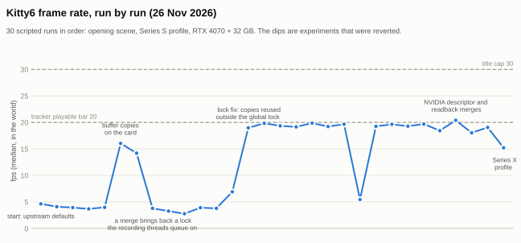
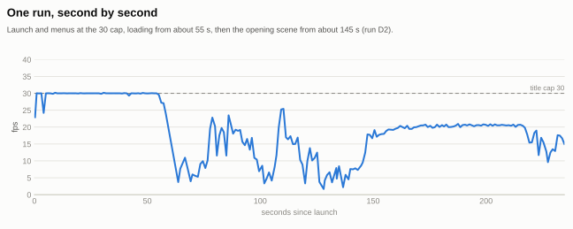
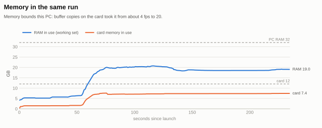
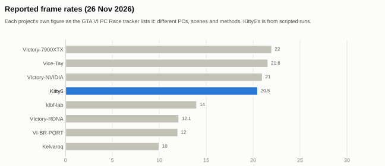
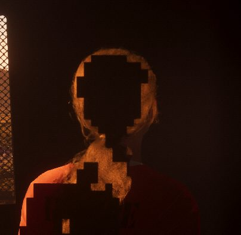
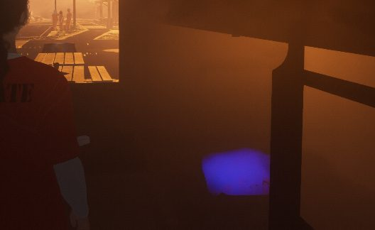

# Kitty6

> **Kitty6 has moved to a new base (27 November 2026).** New work builds on
> [foxhound](https://github.com/readmet3xt-lab/foxhound) by readmet3xt-lab, on the
> [`k6-fox`](https://github.com/kitty-core/Kitty6/tree/k6-fox) branch: on the same PC it ran about twice
> this tree's frame rate in the open world (about 23 fps against 12 at 3,500 draws). Kitty6's tools, switches
> and fixes are being moved there; see its [README](https://github.com/kitty-core/Kitty6/tree/k6-fox#readme)
> and [log](https://github.com/kitty-core/Kitty6/blob/k6-fox/docs/LOG.md). This branch stays as it was, for
> reference.

A fork of [VIctory-7900XTX](https://github.com/avatarmanz/VIctory-7900XTX)
(itself a fork of [VIctory](https://github.com/Marvisak/VIctory)), a
compatibility layer that runs an Xbox Series title natively on Windows from
files the user supplies, tuned for a **mid-range NVIDIA PC: an RTX 4070 (12 GB)
with 32 GB of RAM**.

Nothing from the game is in this repository: only the code that loads,
translates and runs the files you supply ([docs/asset-policy.md](docs/asset-policy.md)).

## Where it stands (26 November 2026)

**Not playable yet.** In-game, with a recognisable picture, below a steady 30 fps.

Live numbers: [Kitty6 Playability](https://kitty-core.github.io)

Measured on one PC: RTX 4070 12 GB (driver 610.88), 32 GB RAM, Windows 11 23H2,
the smaller console's profile (`scripts\play.ps1 -Lean`) unless said otherwise.
These are the maintainer's own figures from runs of about 4 to 5 minutes; none
is a played session yet, and nobody else has reproduced them.

| What | Frame rate |
|---|---|
| Opening scene, Series S profile, standing (frame-rate line, 1 s samples) | 20.5 fps median (48.7 ms) |
| Scripted walking, turning, running (`-Drive`, automated, not play) | 24 to 28 fps, dips to 13 |
| Series X profile at 1080p output (`-Console X -Output 1920x1080`), scripted | 18 to 22 fps |
| Session length without a crash | runs of about 5 minutes so far (no long session yet) |

### In charts

Drawn from the run probes (`docs/probes.md`) by `tools/charts/charts.py`;
each run's figure is its median over its last 45 s, in the world.

<picture>
  <source media="(prefers-color-scheme: dark)" srcset="docs/charts/progress-dark.svg">
  
</picture>

<picture>
  <source media="(prefers-color-scheme: dark)" srcset="docs/charts/run-dark.svg">
  
</picture>

<picture>
  <source media="(prefers-color-scheme: dark)" srcset="docs/charts/memory-dark.svg">
  
</picture>

<picture>
  <source media="(prefers-color-scheme: dark)" srcset="docs/charts/tracker-dark.svg">
  
</picture>

How it got here on this PC, in the order found:

- **4 fps to 15-20 fps**: buffer and window copies in the card's unused memory
  (`VICTORY_CARD_BUFFERS_MB=1536`, `VICTORY_CARD_WINDOWS_MB=1024`).
- **3-5 fps to 18-19 fps**: a lock found with our own sampling profiler
  (`tools/kitty6-prof`): every miss in the copies of buffer views' bytes made a
  buffer and waited for the card while holding a global lock, and the 8 recording
  threads spent about 75% of their time queued on it. Freed copies are now reused
  by size, outside the lock.
- **21 MB less sent each frame**: a 20 MB buffer that shaders rewrite every
  frame, outside the watched memory, is compared and only changed bytes go up.
- **19.7 to 20.5 fps**: upstream's NVIDIA descriptor-slot work (avatarmanz PR #237)
  and texture read-back tracking (PR #150).
- Two of the compute shaders the RTX 4070 refused (they kept a 64-lane wave size)
  now run in waves of 32 (`VICTORY_LDS_REGIONS`, on).

### Known problems

| | |
|---|---|
|  | **Blocky tiles** on heads, hair and backs, and stair-stepped sun shadows: **fixed** (halves by the float path, see the [dev log](docs/LOG.md)). |
|  | **Purple patches** indoors (a fix is on `dev`, not yet checked in the game) and **grey-blue arms**. |

Also: four compute shaders are still refused on NVIDIA (64-lane waves). Mouths
have the 16-bit fix and are not checked yet. The frame is bound by CPU and GPU
memory coherence: about 25 MB up and 35-47 MB fetched back per frame, and the
submitting thread waits for the card about a third of the frame.

**Follow the work:** [`docs/LOG.md` on the `dev` branch](https://github.com/kitty-core/Kitty6/blob/dev/docs/LOG.md)
is updated often. `main` only takes tested changes.

## How to run it

You need Windows 10/11 x64, a CPU with AVX2, a Direct3D 12 GPU with shader model
6.6 and mesh shaders, Rust (the toolchain is pinned), the MSVC build tools, and
your own dump of the title.

```powershell
git clone https://github.com/kitty-core/Kitty6
cd Kitty6
copy victory.example.toml victory.toml      # then set your paths, outside this folder
cargo build --locked --profile diag -p victory --features diagnostics
scripts\play.ps1 -Exe <path of your copy's executable> -Lean
```

Launcher settings (`scripts\play.ps1`):

| Option | What it does |
|---|---|
| `-Lean` | Settings for 32 GB of RAM and a 12-16 GB card (Series S profile, card-memory copies, upstream's renderer patches) |
| `-Console X` / `-Console S` | Pick the console profile; X is the sharper picture |
| `-Output 1920x1080` | The title renders at that output size itself (Series X profile) |
| `-Quality Low/Medium/High` | Texture detail (Medium is what `-Lean` sets) |
| `-Fps 60` / `-Fps 0` | Lift the title's 30 fps cap (off by default) / no cap at all |
| `-Panel` | The run's numbers drawn on the picture; F3 hides and shows them |
| `-F8Timeline` | F8 in game records a 3-frame timeline of where the frame's time went |
| `-Drive` | Scripted walking, turning, running and jumping, for measurements in motion |
| `-Overlay` | The Kitty6 overlay (F6): live graphs of the run |
| `-Probe` | A per-second CSV of frame times; compare runs with `victory probe-report` |

More on running, the commands and every switch: [docs/README-7900XTX.md](docs/README-7900XTX.md)
(upstream's README) and [docs/README-fxceless.md](docs/README-fxceless.md). Every
`VICTORY_...` switch is described in a comment where it is read.

## Tools made here

- `tools/kitty6-prof`: samples every thread's stack of the running process, with
  names from the PDB: per thread and per role (submission, list recorders,
  pools, title threads) what it runs, what it waits on (lock, event, card
  fence, sleep) and from where, call chains, `--focus` for what runs under one
  function; `--json` / `--folded` output, `diff` of two runs and flame graphs
  (`tools/charts/flame.py`). See [docs/profiling.md](docs/profiling.md).
- `apps/kitty6-overlay`: live graphs of the run in a window beside the game.
- **Renderer mods** (`mods/*.k6mod`, `crates/victory-gpu/src/kitty6.rs`): rule files
  of our own that skip a translated shader's draws or run them every n-th frame,
  named by the hash the runtime gives the shader. No title code or data is in them.
  `scripts\play.ps1` passes them unless `-NoMods`.
- **Dev menu** (F4 in game, `-Dev` for a script of it): numbers panel, gameplay
  footage to PNG, frame shots, timelines, autopilot (walk, run, wander), marks, mods
  off/on for A/B timing in one run.
- `tools/charts`: the charts above, from the run probes.
- [Kitty6 Playability](https://kitty-core.github.io): the playability gates, run-by-run
  charts and open issues as a page; `tools/charts/site_csv.py` writes its data.
- The in-picture panel (`-Panel`), F8 timelines (`-F8Timeline`), scripted input
  (`-Drive`, `VICTORY_KEYS`) and per-buffer traffic reports in the log.

## Credits

This is a tree of other people's work with more on top. The history is kept, and
commits taken from elsewhere name the commit and its author.

- **[VIctory](https://github.com/Marvisak/VIctory)** by Marvisak and its contributors.
- **[avatarmanz/VIctory-7900XTX](https://github.com/avatarmanz/VIctory-7900XTX)**:
  the tree this one starts from, and everyone it credits
  ([docs/README-7900XTX.md](docs/README-7900XTX.md#credits)), among them
  fxceless/victory-fork, DexNom, Belobug, FQY55kai, myokex, Geckomacabre and
  cxy0072019-sketch.
- Upstream pull requests carried here: #237 and #150 (NVIDIA descriptors, texture
  read-back), #114 (faces), #329 (picture fixes via RYUKI-7900XT), #314 (ambient
  reflections), by their authors.
- This fork's changes were made with [Claude Code](https://claude.com/claude-code).

## License

GPL-3.0-or-later, as VIctory. See [LICENSE](LICENSE); the one file that is not
covered is named in [docs/asset-policy.md](docs/asset-policy.md).
